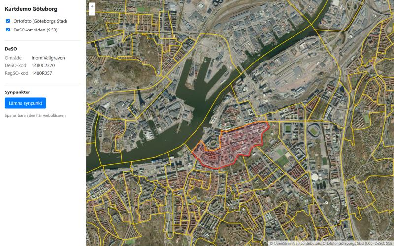

# Kartdemo Göteborg

En liten webbkarta över centrala Göteborg byggd med OpenLayers. Den visar Göteborgs Stads ortofoto via WMS, DeSO-områden från SCB via WFS och låter användaren lämna synpunkter genom att klicka i kartan.

Demo byggd i november 2026.

Länk: https://kartenkat.netlify.app



## Funktioner

- Karta över centrala Göteborg i EPSG:3857 med OpenStreetMap som bakgrund
- Ortofoto från Göteborgs Stad (WMS), kan slås av och på
- DeSO-områden från SCB (WFS, GeoJSON). Klick visar områdesnamn, DeSO-kod och RegSO-kod. DeSO saknar eget namn, så namnet hämtas från det RegSO-område som DeSO ligger i.
- Synpunkter: klicka på "Lämna synpunkt", klicka i kartan och skriv en kort kommentar. Synpunkterna sparas i webbläsarens localStorage.

## Datakällor

- Ortofoto: Göteborgs Stad, https://opengeodata.goteborg.se/services/ortofoto/wms/v1 (CC0)
- DeSO 2025 och RegSO 2025: SCB, https://geodata.scb.se/geoserver/stat/wfs
- Bakgrundskarta: OpenStreetMap-bidragsgivare

Båda tjänsterna skickar CORS-headers, så kartan anropar dem direkt utan proxy.

## Teknik

Vite, React, TypeScript och OpenLayers. Publiceras på Netlify (se `netlify.toml`).

## Köra lokalt

Kräver Node.js 22 eller senare.

```
npm install
npm run dev
```

Öppna sedan http://localhost:5173.
